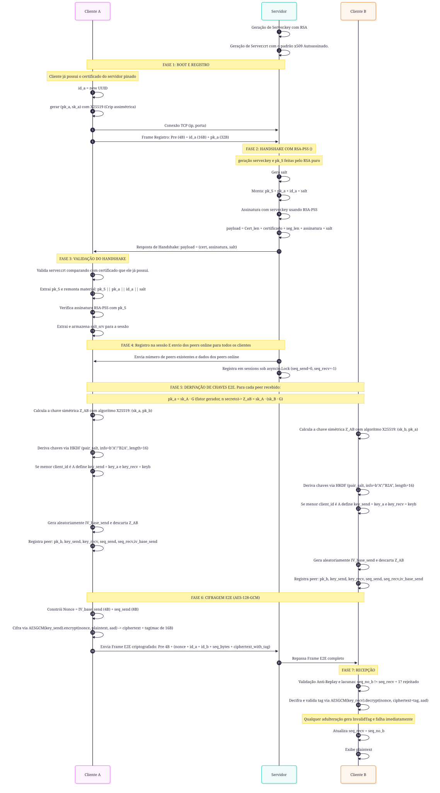
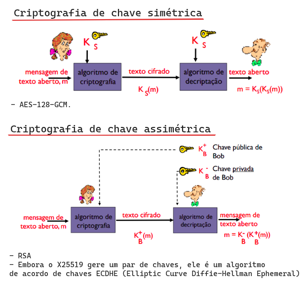
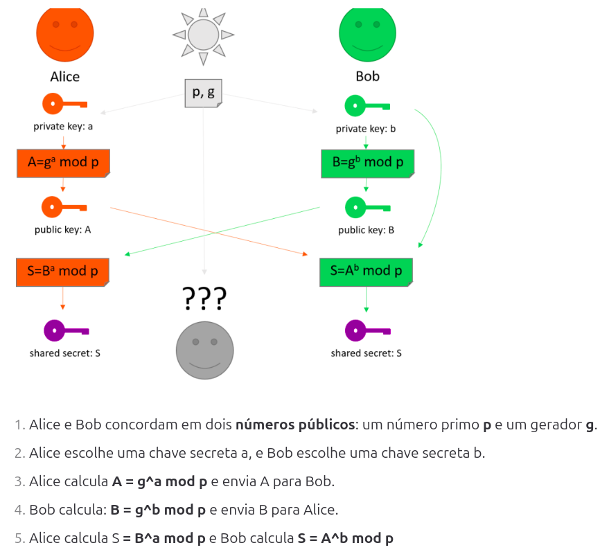
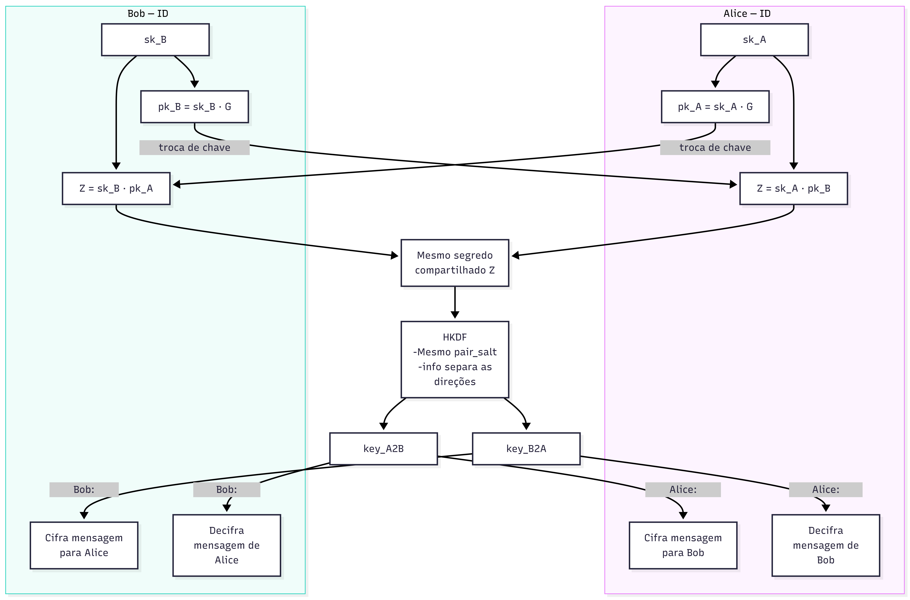
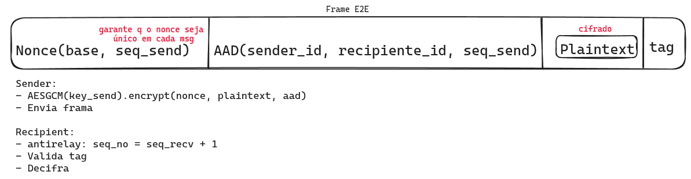

# WhatsUp - Sistema de Mensageria Multi-Cliente (E2E)

## Visão geral

O WhatsUp é uma aplicação de mensageria com criptografia ponta a ponta (E2E). Clientes trocam mensagens cifradas, 
enquanto o servidor atua como relay: ele gerencia conexões e encaminha frames, mas não
decifra o conteúdo das mensagens.


### Garantias

1. **Confidencialidade:** AES-128-GCM (cifragem simétrica) cifra o conteúdo das mensagens e somente o alvo pode decifrar.
2. **Integridade:** a tag de autenticação do AES-GCM detecta adulterações;
3. **Autenticidade:** o servidor é autenticado pelos clientes.
4. **Proteção contra replay:** contadores de sequência por direção rejeitam mensagens repetidas ou "futuras".


## Navegação

- [Visão geral e garantias](#visao-geral)
- [Execução](#execucao)
- [Como acompanhar as fases no código](#como-acompanhar-as-fases-no-codigo)
- [Diagrama de sequência](#diagrama-de-sequencia)
- [FASE 0: Credenciais do servidor](#fase-0-credenciais-servidor)
- [FASE 1: Registro do cliente](#fase-1-registro-cliente)
- [FASE 2: Handshake do servidor](#fase-2-handshake-servidor)
- [FASE 3: Validação do handshake](#fase-3-validacao-do-handshake-cliente)
- [FASE 4: Registro e anúncio de peers](#fase-4-registro-na-sessao-e-anuncio-dos-peers-servidor)
- [FASE 5: Derivação das chaves E2E](#fase-5-derivacao-das-chaves-e2e)
- [FASE 6: Cifragem E2E com AES-128-GCM](#fase-6-cifragem-e2e-com-aes-128-gcm)
- [FASE 7: Recepção, anti-replay e decifragem](#fase-7-recepcao-anti-replay-e-decifragem-cliente-b)

---

## Execução


```bash
python3 -m pip install cryptography
```
```bash
python3 server.py
```
```bash
python3 -m unittest discover -s tests
```
---

Para uma demonstração didática de que o relay não possui a chave AES E2E,
execute:

```bash
python -m tools.demo_e2e_server_cannot_decrypt
```

O script simula uma mensagem entre dois clientes, entrega ao "relay" apenas
o frame e tenta decifrá-lo sem a chave derivada. A tentativa falha com
`InvalidTag`. Isso demonstra a propriedade da implementação, embora nenhuma
demonstração prática consiga provar uma impossibilidade matemática absoluta.

## Conceitos usados no protocolo

### Hash e AEAD

- **Hash:** função determinística e unidirecional que resume dados em um valor
  de tamanho fixo.
- AEAD (Criptografia autenticada com dados associados): é um padrão que os algoritmos de criptografia simétrica implementam (AES-GCM é um algoritmo AEAD) para garantir simultaneamente:
  - **Confidencialidade**: os dados são criptografados.
  - **Integridade**: qualquer modificação nos dados pode ser detectada por meio de uma falha na verificação da tag de autenticação durante a decifragem.
  - **Autenticidade**: garante que os dados vieram de uma fonte confiável.

  - **Dados associados (AAD)**: são informações que não são criptografadas, mas são incluídas no cálculo para gerar a tag de autenticação.
  - **Tag de autenticação**: é um código de verificação para garantir integridade.
  - **Nonce**: valor usado pelo AES-GCM em cada cifragem. Não é secreto e precisa ser único para cada mensagem cifrada com a mesma chave. Neste projeto, ele tem 12 bytes: 4 bytes de base aleatória seguidos por 8 bytes do número de sequência.


### Diffie-Hellman e HKDF

Diffie-Hellman (DH) permite que duas partes obtenham um segredo compartilhado sem
transmiti-lo pela rede. DH puro não autentica o outro lado e, portanto, pode
ser vulnerável a um ataque Man-in-the-Middle (MITM). O handshake RSA-PSS
autentica a resposta inicial do servidor; as chaves públicas dos peers são
distribuídas pelo relay.

HKDF (*HMAC-based Key Derivation Function*) transforma o segredo em
material de chave apropriado, usando um salt e rótulos (`info`) para separar as
chaves de cada direção. Ao contrário do Argon2, que é voltado principalmente
para derivação de chaves a partir de senhas e é deliberadamente custoso em
tempo e memória, HKDF é uma função rápida para derivar chaves de um segredo de
entrada já forte.

### Assinaturas e certificados

Uma assinatura digital é criada com a chave privada do emissor e pode ser
verificada com a chave pública correspondente. Ela comprova integridade e
origem; **não cifra nem torna secreto** o material assinado.

### Entropia

Gerar entropia significa obter aleatoriedade imprevisível. Chaves
criptográficas, salts e bases de IV precisam de fontes aleatórias seguras. Se
um gerador pseudoaleatório usar uma seed fraca ou previsível, valores
criptográficos produzidos por ele podem ser adivinhados.

## Fluxo do protocolo

O fluxo abaixo acompanha as fases do diagrama e a ordem executada pelo código.
Quando a especificação do PDF e a implementação diferem, a diferença é indicada.

### Preparação do servidor

Ao iniciar pela primeira vez, o servidor gera um par RSA e grava o certificado
público em `certs/server.crt` e a chave privada local em `certs/server.key`.
Nos próximos inícios, ambos são reutilizados; a chave privada nunca é enviada
pela rede nem registrada nos logs. O cliente usa `certs/server.crt` como
certificado pinado durante o handshake.

### Fase 1 — Inicialização e registro do cliente

Ao iniciar, cada cliente gera um UUID v4 (`client_id`, 16 bytes) e um par
efêmero X25519. A chave privada (`sk_C`) permanece na memória durante a
execução do cliente; a chave pública (`pk_C`) é serializada em 32 bytes.
Depois, o cliente abre uma conexão TCP assíncrona e envia o frame de registro:

```text
prefixo de tamanho (4B) || client_id (16B) || pk_C (32B)
```

O prefixo é o framing de transporte: um inteiro de 4 bytes em big-endian que
indica o tamanho do payload. Como TCP é um fluxo de bytes sem fronteiras de
mensagens, `recv_frame` lê o prefixo e depois exatamente o tamanho indicado.
Frames maiores que `MAX_FRAME_SIZE` são rejeitados.

### Fase 2 — Handshake autenticado com RSA-PSS

O servidor recebe e valida o frame de registro, gera um `salt_srv` aleatório de
16 bytes e monta o material assinado:

```text
pk_S || pk_C || client_id || salt_srv
```

`pk_S` é a chave pública RSA extraída do certificado. O servidor calcula
`H = SHA256(pk_S || pk_C || client_id || salt_srv)` e assina explicitamente
esse digest com RSA-PSS e SHA-256, usando a chave privada mantida em memória, e
responde:

```text
prefixo de tamanho (4B) ||
[tamanho do certificado] || [server.crt] ||
[tamanho da assinatura] || [assinatura RSA-PSS] || [salt_srv]
```

O cliente compara o certificado recebido com `certs/server.crt`, reconstrói o
material com seu próprio `pk_C` e `client_id` e verifica a assinatura com
`pk_S`. Se o certificado ou a assinatura não corresponder, o handshake é
interrompido (*fail-closed*). O certificado é persistente e deve ser
provisionado fora do canal inseguro; na primeira execução do servidor, ele e a
chave privada local são gerados, e os arquivos não são versionados no Git. O
material assinado trafega em claro: a assinatura comprova integridade, mas não
cifra os dados.

O `salt_srv` autentica e identifica essa resposta do handshake. Ele é gerado
novamente para cada conexão registrada. Quando um peer é anunciado, o servidor
inclui o salt do handshake que criou aquele par; os dois clientes usam esse
mesmo salt somente para derivar as chaves daquela relação.

### Fase 3 — Registro da sessão e anúncios de peers

Depois de responder ao handshake, o servidor entra em `sessions_lock`, envia
ao cliente novo a quantidade de peers online e, em seguida, um frame
administrativo assinado e endereçado para cada peer existente. Também envia um
frame separado, assinado e endereçado, do cliente novo a cada cliente já
conectado. O frame administrativo contém tipo (`JOIN`, `ROTATE` ou `LEAVE`),
`seq_admin`, `announced_id`, `recipient_id`, chave X25519 (ou sentinela de
saída), `salt_srv` e assinatura RSA-PSS.

O contador `seq_admin` é monotônico por processo do servidor, começa em zero e
é alocado sob `sessions_lock`; cada destinatário recebe seu próprio frame e
seu próprio número. O cliente verifica o certificado pinado, o destinatário,
o salt, a assinatura e o contador antes de derivar, substituir ou remover um
peer. Frames administrativos legados sem assinatura são rejeitados.

Um servidor comprometido ainda pode assinar anúncios falsos, pois possui a
chave RSA privada. A assinatura protege contra adulteração ou MITM no canal,
não contra comprometimento do servidor; fingerprints distribuídos fora de
banda ficam como trabalho futuro.

### Fase 4 — Derivação das chaves E2E para cada peer

Após receber a chave pública de outro cliente, cada lado calcula o mesmo
segredo compartilhado:

```text
Cliente A: Z_AB = X25519(sk_A, pk_B)
Cliente B: Z_AB = X25519(sk_B, pk_A)
```

Conceitualmente, isso corresponde a `PK_A = sk_A · G`,
`PK_B = sk_B · G` e `Z_AB = sk_A · (sk_B · G) =
sk_B · (sk_A · G)`. Na implementação, cada lado chama
`private_key.exchange(public_key)`.

O servidor fornece um `salt_srv` aleatório de 16 bytes, autenticado pela
assinatura do handshake. O salt usado por um par é transportado no anúncio
administrativo assinado que estabelece esse par:

```text
pair_salt = announcement.salt_srv
```

Com `Z_AB` e `pair_salt`, HKDF-SHA256 deriva duas chaves de 16 bytes, usando os
rótulos `b"A2B"` e `b"B2A"`. O menor ID do par é A; a chave A é usada no sentido
A→B e a chave B no sentido B→A. Cada cliente escolhe sua chave de envio e
recepção conforme sua posição no par.

Para cada peer, o cliente também gera um `IV_base_send` aleatório de 4 bytes e
inicializa `seq_send=0`, `seq_recv=-1` e `IV_base_recv=None`. O segredo
compartilhado não é mantido na entrada do peer após a derivação. O receptor
aprende a base IV de envio do outro lado a partir do primeiro nonce recebido.

### Fase 5 — Cifragem E2E e relay da mensagem

Ao enviar uma mensagem, o cliente codifica o texto em UTF-8 e cifra com
AES-128-GCM. O nonce tem 12 bytes e é construído com a base IV e a sequência:

```text
nonce = IV_base_send (4B) || seq_send (8B, big-endian)
AAD   = sender_id (16B) || recipient_id (16B) || seq_no (8B)
```

O AAD permanece visível, mas é autenticado pela tag GCM. O payload da
mensagem E2E é:

```text
[nonce (12B)] || [sender_id (16B)] || [recipient_id (16B)] ||
[seq_no (8B)] || [ciphertext || tag GCM (16B)]
```

O frame enviado pela conexão também recebe o prefixo de tamanho de 4 bytes.
`seq_send` só avança depois do envio do frame. O limite de texto claro é 4096
bytes; o maior payload E2E é 4164 bytes, abaixo do limite de transporte de
4200 bytes.

O servidor lê o `recipient_id`, procura a conexão correspondente em `sessions`
e encaminha o payload E2E sem decifrá-lo. Ele atua como relay e não conhece as
chaves simétricas derivadas entre os clientes.

### Fase 6 — Recepção, autenticação e anti-replay

O cliente receptor identifica o remetente pelo ID e exige que ele seja um peer
conhecido. Também exige que a sequência seja exatamente a próxima esperada:

```text
seq_no_recebido == seq_recv + 1
```

Assim, mensagens repetidas, antigas ou com lacunas são rejeitadas. O cliente
decifra com `key_recv`, confere o destinatário esperado e valida a tag GCM.
Também verifica que a base IV recebida não mudou durante a sessão. Uma tag
inválida ou outro erro de validação rejeita o frame; o receptor só atualiza
`IV_base_recv` e `seq_recv` após a validação bem-sucedida e então exibe o texto.

As sequências E2E pertencem ao estado local de cada cliente para cada peer. O
servidor também armazena campos `seq_send` e `seq_recv` na sessão, iniciados
em `0` e `-1`, mas o roteamento e os anúncios de controle atuais não usam esses
campos para autenticar mensagens administrativas.

### Fase 7 — Desconexão

Quando um cliente se desconecta, o servidor remove sua sessão e envia aos
clientes restantes o anúncio de saída com a chave pública sentinela. O cliente
atual não implementa reconexão automática: ao iniciá-lo novamente, um novo ID
e um novo par efêmero X25519 são gerados, e as chaves E2E são derivadas de
novo.

## Exemplo dos contadores por cliente

Cada cliente mantém uma entrada independente para o peer. `seq_send` é o
próximo número a usar para enviar; `seq_recv` é o último número recebido e
aceito.

### Estado que A mantém para B

| Ação | `seq_send` de A para B | `seq_recv` recebido de B |
|---|---:|---:|
| A adiciona B | 0 | -1 |
| A envia mensagem `0` | 1 | -1 |
| A recebe mensagem `0` de B | 1 | 0 |
| A envia mensagem `1` | 2 | 0 |
| A recebe mensagem `1` de B | 2 | 1 |

### Estado que B mantém para A

| Ação | `seq_send` de B para A | `seq_recv` recebido de A |
|---|---:|---:|
| B adiciona A | 0 | -1 |
| B recebe mensagem `0` de A | 0 | 0 |
| B envia mensagem `0` | 1 | 0 |
| B recebe mensagem `1` de A | 1 | 1 |
| B envia mensagem `1` | 2 | 1 |


## Assinatura digital não é criptografia

Quando o servidor calcula
`H = SHA256(pk_S || pk_C || client_id || salt_srv)` e assina esse digest com a
chave privada RSA mantida em memória, ele não cifra os dados originais. A
assinatura permite verificar a integridade e a correspondência com a chave
pública do certificado; o material e o certificado trafegam em claro junto
dela.

A resposta do handshake contém:

```text
[tamanho do certificado] ||
[server.crt (certificado contendo pk_S)] ||
[tamanho da assinatura] ||
[assinatura RSA-PSS] ||
[salt_srv]
```

O cliente compara o certificado recebido com o arquivo local e verifica a
assinatura RSA-PSS com a chave pública do certificado. Como o certificado é
persistente e provisionado fora do Git, essa validação estabelece o pinning
local do servidor. O mesmo certificado é usado para verificar individualmente
os anúncios administrativos de peers.

## Dicionário de termos e mapeamento com os estudos

| Termo | Significado no projeto |
|---|---|---|
| `client_id` | Identificador UUID v4 de 16 bytes do cliente. | 
| `sk` / `pk` | Chave privada (`sk`) e chave pública (`pk`). | 
| `X25519` | Curva usada para o Diffie-Hellman efêmero. |
| `Z_AB` | Segredo bruto compartilhado calculado via ECDH entre A e B. |
| `salt_srv` | Salt aleatório gerado pelo servidor durante o handshake. |
| `HKDF` | Função para derivar chaves de `Z_AB`. |
| `server.crt` | Certificado autoassinado persistente, provisionado fora do Git; contém a chave pública. |
| `RSA-PSS` | Algoritmo de assinatura usado no handshake do servidor. | 
| `AES-128-GCM` | Cifra AEAD que fornece confidencialidade e autenticação. |
| `AAD` | Dados autenticados, mas não cifrados: remetente, destinatário e sequência. | 
| `seq_no` | Contador por direção usado para nonce, ordenação e anti-replay. | 


## Observações sobre X25519 e ECDH

1. Cada parte gera uma chave privada e a chave pública correspondente:

   ```text
   PK_A = sk_A · G
   PK_B = sk_B · G
   ```

2. A troca de segredo pode ser representada conceitualmente como:

   ```text
   Segredo_A = sk_A · (sk_B · G)
   Segredo_B = sk_B · (sk_A · G)
   ```

As fases do protocolo estão implementadas em mais de um arquivo. Use este mapa.

| Fase | Caminho no código |
|---|---|
| 0 - Credenciais do servidor | `server.main()` chama `generate_server_credentials()`|
| 1 - Registro do cliente | `client.main()` gera o ID e o par X25519, monta o registro e chama `send_frame()` em `protocol/framing.py`. |
| 2 - Handshake do servidor | `server.handle_client()` chama `server.registration()`, que usa `create_server_handshake_response()` em `protocol/handshake.py`. |
| 3 - Validação do handshake | `client.main()` verifica a resposta com `verify_server_handshake_response()` em `protocol/handshake.py`. |
| 4 - Anúncio de peers | `server.registration()` envia anúncios assinados; `client.apply_admin_frame()` valida com `verify_admin_frame()` em `protocol/admin.py`. |
| 5 - Derivação das chaves E2E | `client.apply_admin_frame()` chama `client.add_peer()`, que usa `derive_e2e_keys()` em `protocol/crypto.py`. |
| 6 - Envio de mensagem | `client.send_chat_message()` chama `encrypt_e2e_message()` e depois `send_frame()`. |
| 7 - Recepção de mensagem | `client.receive_messages()` chama `validate_and_decrypt_frame()` em `protocol/crypto.py`. |

`client_terminal.py` contém a interface curses e o tratamento das teclas. Ela
recebe estado e a função de envio do `client.py`; assim, a apresentação fica
separada da lógica de protocolo e criptografia.

## Diagrama de sequência




## FASE 0: Credenciais (Servidor)

O WhatsUp usa dois tipos de criptografia:

- **Assimétrica:** usa um par de chaves pública e privada. Nesta fase, o
  servidor usa RSA. X25519 também usa chaves
  assimétricas, mas para os peers derivarem um segredo compartilhado na FASE 5.
- **Simétrica:** usa a mesma chave secreta para cifrar e decifrar. 



O `server.crt` é um certificado X.509 autoassinado que contém a chave pública RSA
do servidor e sua identidade. É público e pode ser compartilhado.
A chave privada correspondente é usada para assinar o handshake e não deve ser compartilhada.

Durante cada inicialização, `server.py` chama
`generate_server_credentials()`, que gera um novo par RSA e grava o certificado
público em `certs/server.crt`. A chave privada fica apenas em memória.

O cliente compara o certificado recebido no handshake com `certs/server.crt` e
usa a chave pública nele contida para verificar a assinatura RSA-PSS. 

## FASE 1: Registro (Cliente)

Quando um cliente é iniciado:

1. **Gera seu id:** um UUID
2. **Gera par de chaves X25519:** `sk_a` (privada) e `pk_a` (pública). São efêmeras: nascem e morrem com esta execução do cliente.
3. Conecta ao servidor.
4. **Envia o frame de registro:** `Pre(4B) || id_a(16B) || pk_a(32B)`. 
- **Prefixo:** informa, em 4 bytes, o tamanho do payload que vem depois dele.

**FRAME**: O TCP é um fluxo de bytes sem fronteiras de mensagem. Por isso todo frame começa com `Pre`, um prefixo de **4 bytes big-endian** declarando o tamanho do payload. 


## FASE 2: Handshake (Servidor)

Assim que o registro chega, o servidor responde provando quem é:

1. Recebe `id_a` e `pk_a`.
2. **Gera um `salt` aleatório** para esta sessão.
4. **Monta o material do handshake:** `pk_S || pk_a || id_a || salt`.
5. **Calcula** `H = SHA256(material)` e assina `H` com **RSA-PSS**, usando sua chave privada.
6. **Responde ao cliente:** `(certificado, assinatura, salt)`.


### Conceito: assinatura digital

Com RSA-PSS, o servidor usa sua chave **privada** para gerar uma assinatura
associada ao material do handshake. O cliente usa a
chave **pública** correspondente para verificar se a assinatura confere com
esse material.


**Assinatura não é criptografia:** Quando o servidor calcula
`H = SHA256(pk_S || pk_C || client_id || salt_srv)` e assina esse com a
chave privada, ele não cifra os dados originais. A
assinatura permite verificar a integridade e a correspondência com a chave
pública do certificado; o material e o certificado trafegam em claro junto
dela.

A resposta do handshake contém:

```text
[tamanho do certificado] ||
[server.crt (contendo pk_S)] ||
[tamanho da assinatura] ||
[assinatura] ||
[salt_srv]
```

**Salt**: valor aleatório usado como "tempero". Para que o mesmo material produza resultados diferentes em sessões diferentes. 

## FASE 3: Validação do handshake (Cliente)

1. **Compara o certificado:** compara o `cert` recebido com o `certs/server.crt` pinado localmente.
2. **Extrai `pk_S`** do certificado.
3. **Remonta o material:** `pk_S || pk_a || id_a || salt` 
4. **Verifica a assinatura** RSA-PSS com `pk_S`. Inválida → **conexão encerrada**.

## FASE 4: Registro na sessão e anúncio dos peers (Servidor)

Com o handshake validado, o servidor integra o cliente à rede:

1. Sob a `sessions_lock` (`asyncio.Lock`) registra a sessão
2. Envia o número de peers online e os dados de cada um.
3. A partir daqui o Cliente A sabe quem está online e com quais chaves públicas.

Os anúncios de peers também são assinados pelo servidor e verificados com o
certificado pinado.

## FASE 5: Derivação das chaves E2E

Cada cliente, ao conhecer um peer, executa independentemente, e chegando ao mesmo resultado:

1. **Calcula o segredo compartilhado:** `Z = sk.exchange(pk_do_peer)` com X25519. O Cliente A usa `sk_a` com `pk_b`; o Cliente B usa `sk_b` com `pk_a`. Ambos obtêm o mesmo segredo `Z`
2. **Deriva as duas chaves de direção com HKDF:**
   - `key_A2B = HKDF(salt=pair_salt, info=b"A2B", length=16)`
   - `key_B2A = HKDF(salt=pair_salt, info=b"B2A", length=16)`
3. **Define o papel pelo menor id:** se meu id < id do peer, sou o "A" deste par → `key_send = key_A2B` e `key_recv = key_B2A`; senão, o contrário. 
4. **Gera o `IV_base_send`:** 4 bytes aleatórios, a base dos nonces desta direção.

### Conceito: Diffie–Hellman

**Como duas partes que nunca se falaram criam um segredo comum, olhando apenas mensagens públicas?**

No X25519, todos os participantes usam a mesma curva e o mesmo gerador. 

```text
pk_A = sk_A · G
pk_B = sk_B · G
```
Para obter o segredo compartilhado, cada lado combina seu escalar privado com a chave pública recebida:

```text
Alice: Z_AB = sk_A · pk_B
Bob:   Z_AB = sk_B · pk_A
```

Ambos chegam ao mesmo ponto:

```text
sk_A · (sk_B · G) = sk_B · (sk_A · G)
```

A figura abaixo ilustra a mesma ideia com o DH clássico usando `mod p`. 



HKDF transforma o segredo em material de chave apropriado, usando um salt e rótulos (`info`) para separar as chaves de cada direção. Ao contrário do Argon2, que é voltado
para derivação de chaves a partir de senhas e é deliberadamente custoso, HKDF é uma função rápida para derivar chaves de um segredo de entrada já forte.

Suponha:
- ID de Alice: `10`
- ID de Bob: `20`
- Ambos calculam o mesmo segredo ECDH: `Z`
- Ambos usam o mesmo `pair_salt`

A partir desses mesmos dados, os dois clientes derivam as mesmas duas chaves:

```text
key_A2B = 1111
key_B2A = 2222
```

Em `derive_e2e_keys`, o menor ID determina a direção. Alice tem o ID menor, então:

| Cliente | `key_send` | `key_recv` |
|---|---:|---:|
| Alice (ID `10`) | `1111` (`key_A2B`) | `2222` (`key_B2A`) |
| Bob (ID `20`) | `2222` (`key_B2A`) | `1111` (`key_A2B`) |

Assim:

- Quando Alice envia para Bob, cifra com `1111`; Bob recebe e decifra com `1111`.
- Quando Bob envia para Alice, cifra com `2222`; Alice recebe e decifra com `2222`.




## FASE 6: Cifragem E2E com AES-128-GCM

Com as chaves key_send e key_recv em mãos, o cliente A escreve para B:

1. **Constrói o nonce:** `nonce = IV_base_send(4B) || seq_send(8B, big-endian)`. O contador embutido garante **nonce nunca repetido**.
2. **Constrói os dados associados AAD:** `sender_id(16B) || recipient_id(16B) || seq_send(8B)`
3. **Cifra:** `AESGCM(key_send).encrypt(nonce, plaintext, aad)` → ciphertext com a **tag de 16 B** anexada.
4. **Envia o frame E2E** ao servidor, endereçado a `id_b`. O servidor **repassa intacto**: não pode ler (não tem a chave) nem adulterar (a tag pega na FASE 7).

### Conceito: AES-GCM e AEAD

O **AES-128-GCM** é um algoritmo de criotigrafia assimétrica **AEAD** (Authenticated Encryption with Associated Data). A tag é o "selo": decifrar com qualquer byte alterado — do ciphertext, do nonce ou do AAD — falha com `InvalidTag`.

**AEAD:**
  - **Dados associados (AAD)**: são informações que não são criptografadas, mas são incluídas no cálculo para gerar a tag de autenticação.
  - **Tag de autenticação**: é um código de verificação para garantir integridade.
  - **Nonce**: valor usado pelo AES-GCM. Não é secreto, mas precisa ser único para cada mensagem.




## FASE 7: Recepção, anti-replay e decifragem (Cliente B)

O cliente B recebe um frame E2E e executa, nesta ordem:

1. **Validação anti-replay:** exige `seq_no == seq_recv + 1`.
2. **Decifra:** `AESGCM(key_recv).decrypt(nonce, ciphertext+tag, aad)`.
3. **`InvalidTag` → mensagem descartada.
4. **Atualiza o contador:** `seq_recv = seq_no`.

A ordem importa: o anti-replay vem antes da decifragem, para que frames repetidos nem cheguem a decifragem.

### Conceito: ataque de replay e os contadores por direção

**Replay** é o ataque em que o adversário **retransmite um frame legítimo antigo**. A mensagem é autêntica (a tag confere) — e ainda assim é uma mentira ("aprove a transferência", de novo).

Para se defender cada cliente mantém **dois contadores por peer**:
- `seq_send` começa em **0**, incrementando a cada mensagem.
- `seq_recv` começa em **-1** e só avança quando chega exatamente o próximo número esperado.

**Exemplo — contadores do Cliente A:**

| Momento | `seq_send` (A) | `seq_recv` (A) | O que acontece |
|---|---|---|---|
| Após a FASE 5 | 0 | -1 | espera receber `seq_no` 0 |
| ENVIA | 0 → 1 | -1 | frame sai com `seq_no` = 0 |
| RECEBE | 1 | -1 → 0 | esperava 0 ✓; decifra |
| ENVIA | 1 → 2 | 0 | frame sai com `seq_no` = 1 |
| RECEBE | 2 | 0 → 1 | esperava 1 ✓; decifra |
| Atacante reenvia o 1º frame de B | 2 | 1 | esperava 2, veio 0 → **rejeitado** |

**Exemplo — contadores do Cliente B (espelho):**

| Momento | `seq_send` (B) | `seq_recv` (B) | O que acontece |
|---|---|---|---|
| Após a FASE 5 | 0 | -1 | espera receber `seq_no` 0 |
| RECEBE | 0 | -1 → 0 | esperava 0 ✓; decifra |
| ENVIA | 0 → 1 | 0 | frame sai com `seq_no` = 0 |
| RECEBE | 1 | 0 → 1 | esperava 1 ✓; decifra |
| Frame com `seq_no` = 3 "do futuro" | 1 | 1 | esperava 2, veio 3 → **rejeitado** |
